# Copenhagen
**실행은 AI에게, 승인은 사용자에게 — AI 에이전트 기반 쇼핑·결제 플랫폼**

사용자가 대화로 원하는 상품을 말하면, AI 에이전트가 상품을 찾아 비교하고 장바구니와 주문서까지 준비합니다.
결제는 사용자가 모바일 앱에서 주문 내용을 확인하고 PIN 또는 생체인증으로 승인했을 때만 이루어집니다.

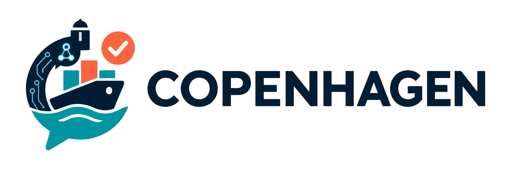

## 기획 배경

온라인 쇼핑의 선택지는 늘었지만, 원하는 상품을 사려면 여전히 여러 판매처를 돌며 가격·재고·옵션·배송 조건을 직접 비교해야 합니다.
LLM 챗봇에게 상품을 물어볼 수는 있어도 대부분 추천에서 끝나고, 알려 준 가격과 재고가 실제와 다를 때도 있습니다.
결국 사용자는 쇼핑몰에 다시 들어가 정보를 확인하고 장바구니와 결제를 직접 진행합니다.

Copenhagen은 상품 탐색과 실제 구매 사이의 이 단절을 잇습니다.

- **탐색에서 구매 준비까지 AI가 수행합니다.** 자연어 요청을 받아 상품을 탐색·비교하고, 고른 상품을 장바구니에 담아 주문서까지 만듭니다.
- **실제 판매처 정보로 구매합니다.** 상품·가격·재고를 판매처에서 조회하고, 결제 전에 Core가 상품·금액·배송 정보를 다시 검증합니다.
- **결제 권한은 사용자에게 남깁니다.** AI의 판단만으로는 결제되지 않으며, 사용자가 앱에서 직접 승인하고 인증해야 결제가 진행됩니다.

## 주요 기능

### 요청부터 결제까지

대화로 요청한 구매가 결제로 끝나기까지의 흐름입니다. 발표 영상의 장면을 순서대로 담았습니다.

<table>
  <tr>
    <td align="center">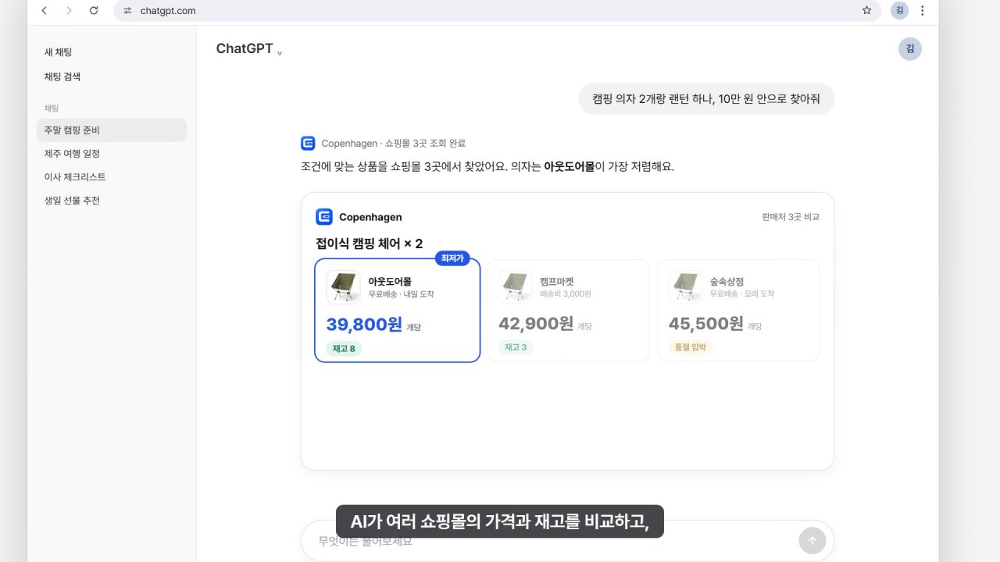</td>
    <td align="center">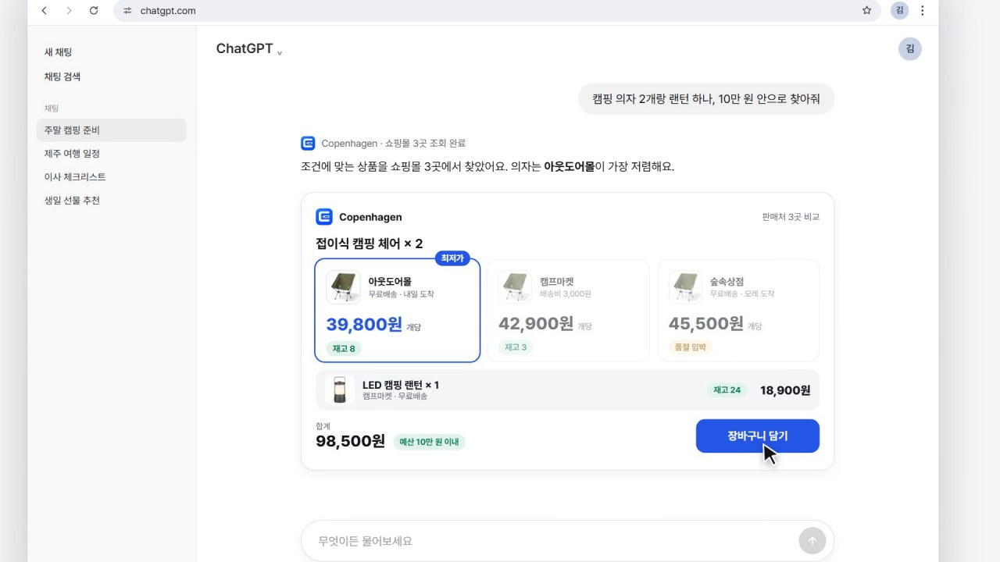</td>
  </tr>
  <tr>
    <td align="center"><b>1. 상품 비교</b> 에이전트가 여러 판매처의 가격과 재고를 비교합니다</td>
    <td align="center"><b>2. 장바구니 구성</b> 고른 상품을 담고 대화 안에서 구매를 시작합니다</td>
  </tr>
  <tr>
    <td align="center">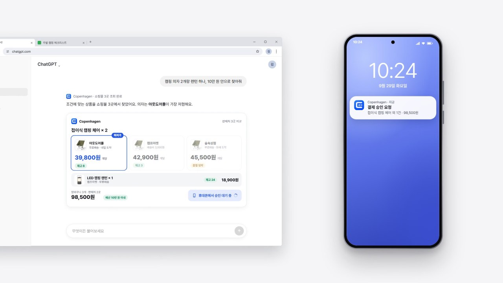</td>
    <td align="center">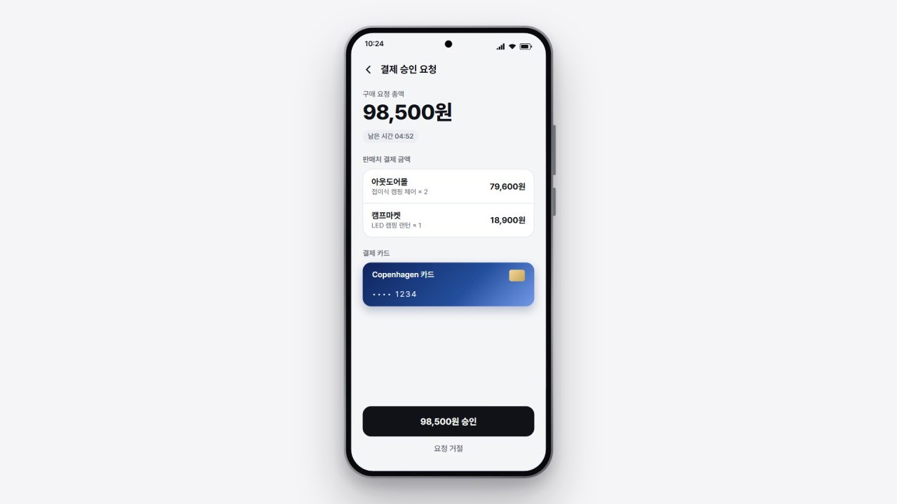</td>
  </tr>
  <tr>
    <td align="center"><b>3. 승인 요청 알림</b> 결제 직전에 멈추고 모바일 앱으로 알림을 보냅니다</td>
    <td align="center"><b>4. 주문 확인</b> 판매처별 금액과 결제 카드를 앱에서 확인합니다</td>
  </tr>
  <tr>
    <td align="center">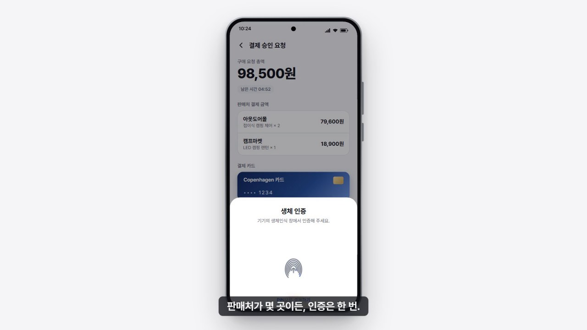</td>
    <td align="center"></td>
  </tr>
  <tr>
    <td align="center"><b>5. 생체 인증</b> 판매처가 여러 곳이어도 인증은 한 번입니다</td>
    <td align="center"><b>6. 결제 완료</b> 판매처별 결제 결과를 보여 줍니다</td>
  </tr>
</table>

### 대화형 상품 탐색과 장바구니

ChatGPT에 Copenhagen을 연결한 뒤 원하는 상품을 말하면, 에이전트가 MCP 도구로 상품을 찾아 장바구니를 구성하고 대화 안에서 결과를 보여 줍니다.

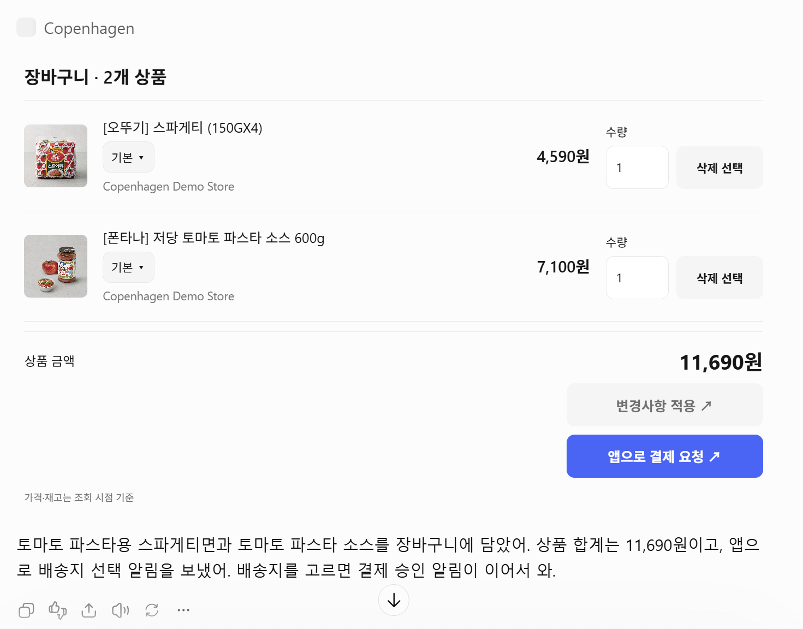

### 모바일 앱 최종 승인

장바구니에서 결제를 요청하면 모바일 앱으로 알림이 갑니다. 사용자는 배송지를 고르고, 주문 내용과 금액을 확인한 뒤 직접 승인합니다.

<table>
  <tr>
    <td align="center"></td>
    <td align="center">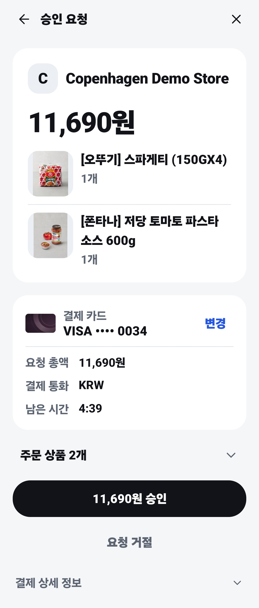</td>
    <td align="center">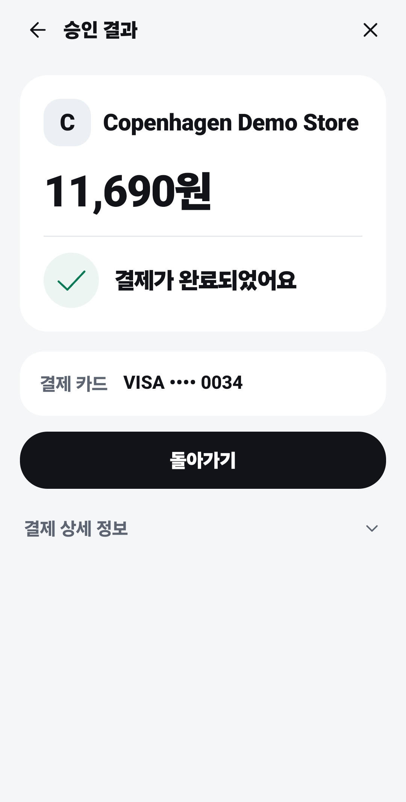</td>
  </tr>
  <tr>
    <td align="center"><b>배송지 선택</b> 주문 상품을 확인하고 배송지를 고릅니다</td>
    <td align="center"><b>승인 요청</b> 판매처·금액·결제 카드를 확인하고 승인합니다</td>
    <td align="center"><b>승인 결과</b> 결제가 끝나면 결과를 바로 보여 줍니다</td>
  </tr>
</table>

### 주문 검증과 결제

Core가 주문서를 다시 검증하고, Pay가 승인 세션·결제 자격(credential) 발급·PG 연동을 처리합니다.
여러 판매처의 상품을 한 번의 승인으로 결제하고, 결과는 판매처별로 보여 줍니다.
PG 응답이 끊겨 결과를 알 수 없는 결제는 다시 요청하지 않고, 기존 거래를 조회해 결과를 확정합니다.

### 이상거래 탐지(FDS)

사용자의 구매 의도와 실제 주문 내용을 비교하고, 금액·빈도·시간대 같은 행동 패턴을 평가해 위험 수준과 추가 확인 권고를 반환합니다.

## 기술 스택

| 영역 | 사용 기술 |
| --- | --- |
| Backend | Java 21, Spring Boot 4.1, Gradle 멀티 프로젝트, Flyway, PostgreSQL, Redis |
| Agent 연동 | MCP(Model Context Protocol) 서버, ChatGPT 플러그인 |
| Mobile | Kotlin, Jetpack Compose, Firebase |
| AI | Python, FastAPI |
| Infra | Docker Compose, Nginx, GitLab CI/CD, AWS EC2 |

각 영역의 실행 방법은 [포팅 매뉴얼](exec/포팅매뉴얼.md)을 참고하세요.

## 시스템 아키텍처

사용자의 구매 조건이 AI Platform과 MCP를 거쳐 Copenhagen으로 들어오고, Copenhagen이 판매처와 주문서를 만들고 사용자 승인을 받은 뒤 PG에 결제를 청구합니다.

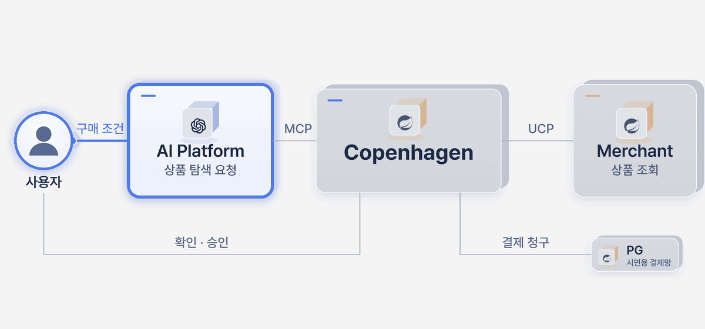

Copenhagen 내부는 아래 서비스로 나뉩니다.

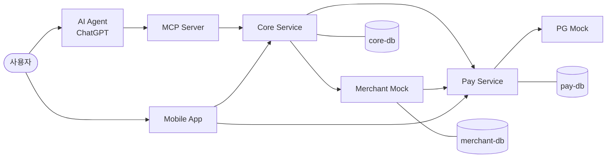

| 모듈 | 책임 |
| --- | --- |
| `mcp-server` | 에이전트의 도구 요청을 Core 호출로 변환 |
| `core-service` | 인증, 장바구니, 주문 검증, 결제 실행 조정, 주문 이력 |
| `pay-service` | 승인 세션, PIN·생체 승인, 결제 자격 발급, PG 연동 |
| `ucp-merchant-mock` | 상품 조회·주문 생성 등 외부 판매처 시뮬레이션 |
| `pg-mock` | 결제 승인과 결과를 내는 외부 PG 시뮬레이션 |

## 팀원

| 이름  | 역할              |
|-----|-----------------|
| 허정원 | 팀장 · Backend(Core) |
| 김지윤 | Backend(Pay) |
| 김지호 | AI · MCP |
| 김호준 | Backend(Merchant) · AI |
| 박건우 | Infra · Frontend(Mobile) |

## Repository

- `backend/apps/`: Core, MCP, Pay 애플리케이션
- `backend/mocks/`: 판매처(Merchant)와 PG 시뮬레이터
- `backend/libs/`: 서비스 간 계약과 공용 DTO·검증
- `mobile/`: Kotlin + Jetpack Compose 안드로이드 앱
- `ai/`: FastAPI 기반 이상거래 탐지(FDS) 평가 모듈
- `infra/`: Docker, Nginx, GitLab CI/CD 설정
- `docs/`: 아키텍처, API, 결제 관련 문서
- `exec/`: 포팅 매뉴얼과 시연 자료

## Collaboration

- [Contributing Guide](CONTRIBUTING.md)
- [AI Agent Instructions](AGENTS.md)
- [문서 인덱스](docs/README.md)
- [프로젝트 개요](docs/project-overview.md)
- [서비스와 데이터 소유권](docs/architecture/README.md)
- [구매 흐름과 설정](docs/api/mcp-mobile-purchase-flow.md)
- [GitLab CI/CD와 EC2 배포](infra/gitlab/README.md)
