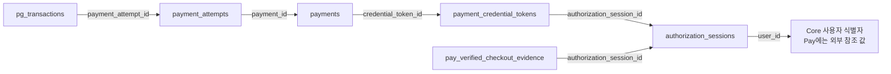
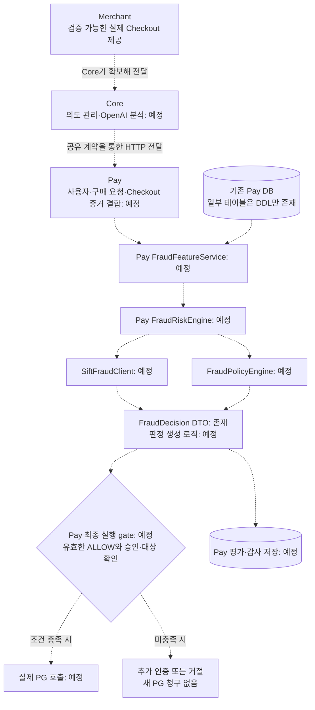

# Pay ERD 기반 Fraud Detection 통합 검토 보완자료

작성일: 2026-09-09 · 관련 작업: `S15P21A207-213` · 상태: **현황 조사 및 통합 제안, 팀 합의 전**

## 1. 문서 목적과 조사 기준

Pay가 보유한 데이터로 Fraud Detection을 어디까지 구현할 수 있는지 정리하고, Core·Pay·Merchant·AI 담당자의 구조를 합칠 때 사용할 검토 기준을 남긴다. 이 문서의 후보 필드·컴포넌트·테이블은 별도 표시가 없으면 구현 완료나 팀 합의를 의미하지 않는다.

| 근거 | 조사 기준 |
| --- | --- |
| 사용자 제공 ERD | `Pay 논리적 ERD.pdf`, 1페이지. 왼쪽 개요도와 오른쪽 상세 테이블을 확인 |
| PDF 식별값 | SHA-256: `dbd1473bf50c4d7f2565ecb28a18e4adcf5ae71fb1079a4816863e05013fc494` |
| 코드 기준 | HEAD `5a3c18cca635e55970d157351a33823c5a87b24f`의 Java 소스, Flyway V1~V5, 설정, 계약 README |
| 기존 분석 | [최초 결제 흐름 조사](current_payment_flow.md), [Fraud 아키텍처 초안](fraud_architecture_plan.md) |
| 현재 공통 모델 | [internal-api-contract의 Fraud 계약](../../backend/libs/internal-api-contract/README.md) |

PDF는 저장소에 포함되지 않은 사용자 제공 자료다. 다른 담당자가 로컬 Downloads 경로에 접근하지 않아도 검토할 수 있도록 필요한 테이블·필드와 코드 차이를 본문에 기록했다. 원본을 대조할 때는 위 파일명과 해시가 같은 자료를 사용한다.

기존 분석 문서는 `9150e476...` 시점의 기록이다. 그 이후 승인 세션·결제 상태 전이·Pay 스키마·공통 Fraud 모델이 추가되었으므로, 당시의 “구현 없음”을 현재 전체 상태로 해석하지 않는다. 이 보완자료도 위 HEAD의 정적 조사이며, 다른 담당자의 미병합 브랜치나 실행 DB의 데이터 적재 여부는 확인하지 않았다.

## 2. 판단 요약

**현재 ERD는 Pay의 기본 규칙 검사, 거래 이력 기반 피처, Sift 연동 입력을 구성하는 기반으로 사용할 수 있다. 사용자 구매 의도와 실제 Checkout의 일치 여부를 검사하려면 Core가 제공하는 의도 정보가 추가로 필요하다.**

| 대상 | 데이터 관점의 가능 범위 | 현재 구현 상태 |
| --- | --- | --- |
| 공통 모델·설정 | 기존 Java record/enum과 서비스별 설정 재사용 | 구현 존재 |
| 승인·소유권·만료·결제 대상 검사 | 승인 세션, 결제수단, Mandate, Credential 참조 활용 | 일부 기존 검증·상태 전이 존재. 이를 종합하는 Fraud 규칙은 현재 구현 없음 |
| 거래 빈도·금액·실패 이력 피처 | 결제와 시도·PG 결과를 시점별로 집계 | 테이블 정의 존재. Fraud 집계는 현재 구현 없음 |
| Sift 기본 연동 | 사용자·거래·금액·통화·판매처를 외부 이벤트에 매핑 | 결과 모델·설정만 존재. 외부 API 호출은 현재 구현 없음 |
| 구매 의도 분석 | 원래 의도와 검증된 실제 구매 내용을 비교 | `PurchaseIntent`, `IntentAnalysisResult` 계약만 존재. 수집·전달·분석은 현재 구현 없음 |
| 최종 실행 전 판단·감사 | 입력을 결제 대상에 결합하고 결정·근거 저장 | `FraudDecision` 계약만 존재. Risk Engine·실행 gate·감사 저장은 현재 구현 없음 |

기존에 수집한 AI 데이터셋·AI DB·CSV 피처 매핑은 재사용하지 않는다. 별도 AI DB나 신규 배포 서비스를 전제로 하지 않고, 기존 서비스 책임과 DB 소유권 안에서 보완한다.

## 3. ERD와 실제 코드의 차이

| 확인 대상 | 현재 코드에서 확인한 사실 | 통합 시 의미 |
| --- | --- | --- |
| 승인 요청 수신 | `AuthorizationSessionController.create()`가 `POST /internal/v1/payment-approvals` 수신 | 기존 내부 API를 전달 계약의 확장 후보로 검토 |
| 승인 세션 생성 | `AuthorizationSessionService.create()`가 요청 형식, 활성 Merchant, 결제수단 선택, 멱등성을 처리하고 세션 저장 | 기존 생성·검증·멱등 처리를 재사용. 이 함수가 사용자 최종 승인을 완료하는 것은 아님 |
| 표시용 상품 정보 | `AuthorizationDisplaySnapshot.SummaryItem`에 `name`, `option`, `quantity`, `amountMinor` 존재. V5가 `authorization_sessions.display_snapshot` 추가 | 첨부 ERD에 없는 후속 구현. 상품 요약을 받을 수 있지만 Merchant 서명으로 검증된 원본과 구분 |
| Checkout 원본 | `CreateAuthorizationSessionCommand.checkoutArtifact`는 `JsonNode`. `AuthorizationSessionService.validate()`는 JSON 객체인지 검사 | 상품·브랜드·카테고리 등 내부 필드의 계약이 확정되었다고 볼 수 없음 |
| Checkout 검증 증거 | V2에 `pay_verified_checkout_evidence` 존재 | 해당 테이블 저장 및 Checkout 서명 검증 서비스는 **현재 구현 없음**. DDL만으로 검증된 데이터가 적재된다고 가정하지 않음 |
| 결제 상태 관리 | `PaymentLifecycleService.markProcessing()`, `resolveSuccess()`, `resolveDefinitiveFailure()`, `markUnknown()` 존재 | 상태 전이 기능이며 실제 PG 호출 함수가 아님. 최종 Fraud 삽입점은 향후 PG 실행 경계를 확인한 뒤 확정 |
| 사용자별 결제 연결 | `JdbcPaymentRepository.findAuthorizationSessionId()`가 결제에서 Credential을 통해 승인 세션 조회 | 이 경로를 확장해 Pay DB 내부에서 사용자별 이력을 조회할 수 있음 |
| 통화 | V3와 승인 요청 검증은 현재 `KRW`만 허용. 공통 `PurchaseIntent`는 ISO 4217 통화 허용 | 공통 모델의 통화 허용 범위와 Pay MVP 지원 범위를 구분 |

핵심 근거: [승인 Controller](../../backend/apps/pay-service/src/main/java/com/copenhagen/pay/payment/authorization/AuthorizationSessionController.java), [승인 Service](../../backend/apps/pay-service/src/main/java/com/copenhagen/pay/payment/authorization/AuthorizationSessionService.java), [표시용 Snapshot](../../backend/apps/pay-service/src/main/java/com/copenhagen/pay/payment/authorization/AuthorizationDisplaySnapshot.java), [결제 Lifecycle](../../backend/apps/pay-service/src/main/java/com/copenhagen/pay/payment/payment/PaymentLifecycleService.java), [JDBC 결제 Repository](../../backend/apps/pay-service/src/main/java/com/copenhagen/pay/payment/payment/JdbcPaymentRepository.java).

## 4. Pay 데이터 재사용 범위

### 4.1 테이블과 피처 후보

아래 검사는 **향후 구현 후보**다. 기존 데이터의 조회·집계·판정 코드가 모두 존재한다는 의미는 아니다.

| 테이블 | 재사용할 값 | 검사·피처 후보 | 제한 |
| --- | --- | --- | --- |
| `authorization_sessions` | `user_id`, `purchase_request_id`, `merchant_account_id`, `external_checkout_id`, `checkout_digest`, `amount_minor`, `currency`, `status`, `auth_method`, `approved_at`, `expires_at`, `version` | 승인 상태·유효기간·대상 일치 | 승인 상태만으로 Fraud 통과를 의미하지 않음 |
| `merchant_accounts` | `id`, `merchant_id`, `status` | 요청 판매처 식별·활성 상태 | 실제 판매처가 사용자의 허용 판매처인지는 별도 의도 필요 |
| `payment_methods` | `id`, `user_id`, `provider`, `status`, `deleted_at` | 소유권·활성 결제수단 검사 | `brand`는 카드 브랜드. 상품 브랜드가 아님 |
| `payment_pin_credentials` | `failed_attempts`, `locked_until`, `status` | 현재 실패·잠금 신호 | 누적 이력 테이블이 아님. 성공 시 검증 상태를 초기화하는 코드가 있어 기간별 실패 건수로 해석 불가 |
| `biometric_credentials`, `biometric_challenges` | 사용자·등록 기기 참조, Challenge의 세션·상태·만료·사용 시각 | 등록 인증수단 및 Challenge 상태 검사 | 등록된 `device_id`만으로 현재 결제 요청의 기기나 Sift 기기 지문을 알 수 없음 |
| `checkout_mandates`, `payment_mandates` | 승인 세션, Checkout digest, 금액·통화, 상태·발급·만료 | 승인 증거의 대상·유효기간 검사 | 서명된 artifact 처리와 검증 동작을 담당 구현과 대조해야 함 |
| `payment_credential_tokens` | 승인·Mandate 참조, Checkout, 금액·통화, 상태·만료·사용 시각 | 재사용·만료·대상 변경 방지 | 검증과 소비의 동시성 처리가 필요. `token_hash`나 암호문을 AI 분석 입력으로 사용하지 않음 |
| `payments`, `payment_attempts`, `pg_transactions` | 거래 금액·상태·시각, 시도 번호, 오류·응답 코드 | 거래 빈도·누적 금액·이전 실패 비율·평소 금액 대비 변화 | 현재 거래의 미래 성공/실패를 사전 피처로 사용하지 않음. 결제 실패와 사기 확정은 별개 |
| `pay_verified_checkout_evidence` | `canonical_checkout_json`, digest, 서명 검증 결과, 판매처·금액·통화·만료 | 검증된 실제 구매 내용 스냅샷 | 테이블만 존재. JSON schema와 실제 검증·저장 구현 필요 |
| `payment_receipts`, `payment_reconciliation_jobs` | 결과 영수증, 재조정 상태·횟수·시각 | 결과 추적과 불확정 거래 구분 | 영수증이나 재시도 실패가 Fraud 판정 근거 그 자체는 아님 |

### 4.2 사용자별 거래 이력 연결

아래 화살표는 기존 SQL의 참조 관계다. 외부 서비스 호출이나 구현된 Fraud 데이터 수집 흐름이 아니다.

`payments`에 `user_id`를 중복 추가하기 전에 위 연결을 재사용한다. 조회 기간·기준 시각·현재 거래 포함 여부·동일 요청 재전송 제외 기준을 정의하고, 필요한 인덱스는 실제 조회 계획과 데이터 규모를 확인한 뒤 추가한다. 상태와 시각만으로 “그 시점에 이미 알고 있던 결과”를 재현하기 어려운 경우에는 감사 스냅샷이나 상태 변경 이력이 추가로 필요하다.

## 5. 공통 모델에 대한 데이터 매핑

### 5.1 PurchaseIntent

`PurchaseIntent`는 **사용자가 원한 구매 조건**이다. Pay가 받은 실제 결제 요청에서 의도를 역으로 만들어서는 안 된다.

| 필드 | Pay에서 확보 가능한 정보 | 통합 시 필요한 결정 |
| --- | --- | --- |
| `intentId` | 의도 전용 식별자 없음 | Core에서 생성·전달. `purchaseRequestId`와 같은 ID를 쓸지는 별도 합의 |
| `userId` | 승인 세션과 결제수단의 `user_id` | 인증된 Core 요청의 사용자와 Pay 승인 주체를 결합 |
| `productKeywords` | 표시용 상품명은 있으나 원래 요청 키워드는 없음 | 사용자 요청에서 Core가 보존·전달 |
| `category` | 명시된 상품 카테고리 필드 없음 | Core/Merchant 계약에서 필요 시 확보. JSON 안에 있다고 가정하지 않음 |
| `brand` | 결제수단의 카드 브랜드는 존재 | 상품 브랜드는 Core/Merchant에서 확보 |
| `quantity` | 표시용 실제 상품 수량 존재 | 사용자가 요청한 수량은 별도 전달. 복수 상품에서 필드의 적용 범위 합의 |
| `maxTotalAmount` | 실제 결제 금액만 존재 | 사용자가 허용한 최대 예산을 Core에서 전달 |
| `currency` | 승인·결제의 통화 존재 | 의도 통화와 실제 결제 통화를 구분해 비교. 현재 Pay는 KRW만 지원 |
| `purpose` | 사용자 구매 목적 없음 | Core가 사용자 요청에서 확보 |
| `allowedMerchants` | 현재 거래 판매처만 존재 | 사용자가 허용한 판매처 목록을 별도 전달 |
| `constraints` | 원래 사용자 제약 없음 | Core에서 전달. 자유 서술 제약과 실행 가능한 규칙을 구분 |
| `createdAt` | 승인 세션 생성 시각 존재 | 의도 생성 시각은 Core에서 전달. 세션 생성 시각으로 대체하지 않음 |
| `expiresAt` | 승인·Credential 만료 존재 | 의도 유효기간을 별도 전달. 승인 만료와 같은 의미로 취급하지 않음 |

현재 생성자 필수값은 `intentId`, `userId`, `createdAt`이다. 미지정 제약은 nullable 필드나 빈 목록으로 표현하며, 금액이 있으면 통화도 필요하다. **객체 생성이 가능하다는 사실과 의미 있는 Fraud 평가에 충분한 정보가 있다는 사실은 다르다.**

예를 들어 사용자가 “10만 원 이하의 A 브랜드 운동화”를 요청했는데 Pay에는 “B 브랜드 상품 12만 원 결제”만 들어오면, Pay 데이터만으로 원래의 예산·브랜드 위반을 판단할 수 없다. Core가 확인한 의도와 검증된 Checkout이 함께 있어야 한다.

### 5.2 분석·판정 결과 모델

아래 값들은 ERD에서 미리 꺼내야 하는 원천 데이터가 아니라 향후 컴포넌트가 생성하는 결과다.

| 공통 모델 | 향후 생성 주체 제안 | 생성에 필요한 입력 | 결측 처리 및 경계 |
| --- | --- | --- | --- |
| `IntentAnalysisResult` | Core의 `OpenAIIntentAnalyzer` | 의도와 실제 Checkout의 의미 비교 자료 | 분석이 없으면 `FraudDecision.intentAnalysis=null`. 분석기가 직접 결제 권한을 발급하지 않음 |
| `SiftFraudResult` | Pay의 `SiftFraudClient` | 검증된 거래 이벤트와 외부 응답 | `available=false`면 점수·위험도·Workflow 결정을 null로 유지. 0점/LOW로 대체하지 않음 |
| `RuleResult` | Pay의 `FraudPolicyEngine` | 승인 무결성, 명시적 제약, 거래 피처 | `passed`, `severity`, `reason`을 반환. 필수 무결성 위반과 선택적 위험 신호의 집계 정책은 별도 정의 |
| `FraudDecision` | Pay의 `FraudRiskEngine` | Sift·의도 분석·규칙 결과와 평가 대상 | 공유 DTO에는 결제 대상·정책 버전·유효기간이 없음. 실행권으로 직접 사용하지 않음 |

실제 enum은 `ALLOW / REQUIRE_AUTH / DENY`다. 위험도와 규칙 심각도는 각각 `LOW / MEDIUM / HIGH / CRITICAL`이다. 최초 설계의 `HOLD / REQUIRE_REAPPROVAL`을 구현된 enum으로 사용하지 않는다.

## 6. 서비스 책임과 전달 계약 제안

### 6.1 책임 배치

| 담당 영역 | 소유할 책임 | 다른 담당자에게 제공할 것 |
| --- | --- | --- |
| MCP | 사용자 요청과 인증 맥락을 Core로 전달 | 출처가 있는 구매 요청. Agent가 작성한 요약만으로 사용자 승인을 확정하지 않음 |
| Core | 구매 의도 원본·수정본 관리, 의도 분석, 구매 흐름 조정 | `PurchaseIntent`, 분석 결과, 구매 요청·Checkout과의 연결 정보 |
| Merchant | 실제 상품·가격·수량·Checkout 자료 | 합의된 상품 schema와 검증 가능한 Checkout 증거 |
| Pay | 승인·결제수단·Credential 검증, 피처·Sift·규칙·최종 판정·감사 | 결제 대상에 결합된 결정과 추가 인증 요구·결제 결과 |
| Frontend/Mobile | 사용자에게 내용 표시, 명시적 승인·추가 인증, 필요 시 현재 기기·세션 전달 | 확인 대상과 연결된 인증 결과. 기기 정보 수집 범위는 별도 합의 |
| 공유 계약 모듈 | DTO·schema·enum·입력 validation | 버전과 결측 의미가 일치하는 데이터 계약 |

이는 최초 Fraud 설계의 배치를 이어받은 통합 제안이다. 서비스별 DB 단독 소유와 애플리케이션 구현 간 Gradle 의존 금지를 유지한다. Core→OpenAI 및 Pay→Sift의 외부 호출 허용 범위는 실제 연동 시 서비스 문서·ADR에 반영할 합의 항목이다.

다음 그림은 **향후 흐름**이다. 공통 모델과 기존 Pay DB 외의 Fraud 서비스·엔진·저장 연결·실행 gate는 현재 구현 없음이다.

### 6.2 Core → Pay 계약에서 추가로 합의할 값

기존 진입 후보는 `POST /internal/v1/payment-approvals`다. 아래 표는 **확장 후보이며 현재 API가 수신·저장하는 필드로 간주하지 않는다.** 별도 엔드포인트가 필요한지는 담당자와 합의한다.

| 계약 요소 | 기존/신규 구분 | 검토 내용 |
| --- | --- | --- |
| `purchaseRequestId`, `userId`, `merchantId`, `checkoutId`, `checkoutDigest` | 기존 요청 필드 | 의도·분석·승인 대상이 동일한지 결합 검증 |
| `checkoutArtifact`, `display`, `amountMinor`, `currency` | 기존 요청 필드 | 표시용 자료와 권위 있는 Checkout 구분. 서명·digest·금액 일치 검증 |
| `purchaseIntent`, `intentAnalysis` | 새 전달 필드 후보 | 기존 공통 record를 재사용. 분석 결측·실패와 정상 결과를 구분 |
| 의도 revision 또는 내용 digest | 새 메타데이터 후보 | 승인 후 수정된 의도를 이전 분석·승인과 함께 사용할 수 없도록 연결 |
| 계약 버전·분석 시각·분석기 버전 | 새 메타데이터 후보 | 서비스 버전 차이, 오래된 분석 재사용, 재현 가능성 처리 |
| `authorizationSessionId` 및 승인 version | Pay가 생성·관리할 평가 연결 값 | 생성 요청에 이미 존재한다고 가정하지 않고, Pay 세션 생성 후 연결 |

구체 DTO 이름·필드명·전송 위치는 확정하지 않았다. 공유 `FraudDecision`에 모든 실행 메타데이터를 무조건 추가하기보다, Pay 내부 평가 컨텍스트와 저장 모델에서 결제 대상·유효기간·정책 버전을 결합하는 방식을 우선 검토한다.

Pay는 Core/Merchant DB를 직접 조회하지 않는다. 신뢰하는 내부 호출을 확인한 뒤 전달 자료를 검증하고, 이후 Merchant 결제 요청에는 저장한 증거를 사용한다. Merchant가 보낸 임의의 `fraudApproved`나 점수를 승인 근거로 사용하지 않는다.

## 7. Sift 연동 시 데이터 보완

사용자 식별자, 거래 식별자, 금액·통화, 판매처, 결제 상태는 기본 이벤트 구성에 활용할 수 있다. Sift는 거래 이벤트와 판단 결과를 전달하고 주요 시점에 점수를 조회하는 연동을 안내한다. 실제 이벤트 종류·필수 필드·제품 설정과 재전송 방식은 Client 구현 전에 확정한다. [Sift 결제 연동 가이드](https://developers.sift.com/guides/payment-gateway)

| 추가 정보 | 현재 Pay ERD에서의 상태 | 처리 방향 |
| --- | --- | --- |
| 현재 사용자 IP·브라우징 세션 | 전용 저장 필드 확인되지 않음 | 필요 시 실제 사용자 접점에서 전달. Core/Merchant 서버 IP를 사용자 IP로 대신하지 않음 |
| 현재 기기·행동 정보 | 생체인증 등록 기기 참조만 존재 | 등록 기기와 현재 요청 기기를 구분. 수집 가능 여부와 출처 합의 |
| 사용자 가입 시각·계정 변경 이력 | Pay에 사용자 프로필 테이블 없음 | 필요할 때 Core 소유 데이터의 최소 전달 계약 검토 |
| 상품 카테고리·상품 브랜드 | 명시적 필드 없음 | Merchant/Core 상품 계약 확인. 카드 브랜드로 대체하지 않음 |
| 사기 확정·분쟁·차지백 라벨 | 현재 V2~V5에 해당 테이블 없음 | 일반 결제 실패와 구분. 향후 운영 결과 피드백 계약 검토 |

이 정보가 전부 없다고 기본 연동이 불가능한 것은 아니지만, 어떤 위험을 판별할 수 있는지와 탐지 성능은 실제 이벤트·결과로 검증해야 한다. Sift 가이드도 수집 가능한 행동 정보와 거래·판단 결과의 축적을 설명한다. 등록된 기기 ID 하나가 전체 행동 신호를 대체하지는 않는다. [Sift 결제 연동 가이드](https://developers.sift.com/guides/payment-gateway)

금액 단위도 어댑터에서 변환해야 한다. 프로젝트의 `amountMinor`와 `maxTotalAmount`는 통화 최소 단위 정수다. Sift `$transaction.$amount`는 통화 기본 단위의 micros를 사용한다. 현재 KRW 기준 1원은 1,000,000 micros이며, 변환 시 정수 오버플로를 검증해야 한다. 공통 모델의 금액 단위를 외부 API 단위로 바꾸지는 않는다. [Sift Transaction API](https://developers.sift.com/docs/curl/events-api/reserved-events/transaction)

현재 환경변수와 검증 조건은 [.env.example](../../.env.example), [Core 설정 안내](../../backend/apps/core-service/README.md), [Pay 설정 안내](../../backend/apps/pay-service/README.md)를 따른다. `FRAUD_DETECTION_ENABLED=true`는 아직 탐지를 실행하지 않는다. Sift 임계값 두 개는 미설정 가능하며, 설정하면 `0 <= review < deny <= 1`이어야 한다. 실제 운영 정책과 실패·시간 초과 시 행동은 별도 합의한다.

외부 분석에는 필요한 식별·금액·상태·상품 정보만 매핑한다. PIN 해시, 카드번호, CVC, 비밀번호, Credential token/암호문, 서명 artifact 원문을 공통 Fraud 모델이나 외부 분석 자료에 추가하지 않는다.

## 8. DB 변경과 기존 코드 재사용 제안

| 작업 | 기존 구조 재사용 | Migration 판단 |
| --- | --- | --- |
| 공통 모델·설정 | `internal-api-contract`와 Core/Pay 설정 | 현재 완료 범위에는 불필요 |
| 사용자별 거래 피처 | 기존 승인·Credential·결제·시도·PG 테이블을 Pay 내부에서 조회 | 컬럼 추가를 먼저 가정하지 않음. 조회 성능 검증 후 인덱스 필요 여부 판단 |
| Checkout 증거 저장 | 기존 `pay_verified_checkout_evidence`의 JSONB 및 검증 메타데이터 | 현재 필드로 충분하면 불필요. 검증·저장 구현과 JSON 계약은 필요 |
| 원본 의도 관리 | Core 소유 저장 구조 검토 | 의도 영속화는 현재 구현 없음. 통합 시 Core의 실제 구현과 비교한 뒤 결정 |
| Pay가 받은 의도·분석 스냅샷 | 승인·Checkout 증거와 연결하는 저장 구조 후보 | 전용 저장소가 현재 없어 추가 schema 필요 여부 합의. 서명된 Checkout JSON에 의도를 임의로 섞지 않음 |
| Fraud 결정·감사 기록 | Pay의 JDBC/Flyway 방식 사용 | 새 영속 기록을 추가한다면 Pay 소유 migration 필요. 기존 Fraud 감사 테이블은 없음 |

감사 저장 후보에는 평가 ID, `traceId`, 구매 요청·승인 세션·Checkout digest, 의도 revision/digest, 결정과 reason code, 평가 시각, 정책·모델 버전, 외부 응답 참조, 결측/timeout 여부가 필요하다. **후보 항목이며 현재 컬럼이 아니다.** PG 호출 전 거절된 평가도 남겨야 하므로 아직 생성되지 않았을 수 있는 `paymentId`만을 필수 연결 키로 삼지 않는다. 민감 원문 대신 필요한 최소 근거를 저장하고 보관 기간은 합의한다.

기존 Flyway V2~V5를 수정하지 않는다. 다른 담당자의 migration과 병합한 최신 버전을 확인한 뒤 다음 버전을 배정한다. 특정 신규 테이블명·migration 번호는 이 문서에서 선점하지 않는다.

## 9. 통합 전에 합의할 항목

담당자는 개인 이름 대신 역할로 표시했다. 모든 항목은 **미합의** 상태이며, 실제 합의 후 결정 내용과 ADR/API 문서 링크를 마지막 열에 기록한다.

| ID | 검토 항목 | 협의 담당 | 완료 조건 / 결정 기록 |
| --- | --- | --- | --- |
| INT-01 | 의도 소유권과 `intentId`/`purchaseRequestId` 관계 | Core·AI·Pay | 생성 주체·수정 revision·사용자 확인 기준 확정. 미합의 |
| INT-02 | 상품/Checkout JSON 계약과 서명 검증 | Merchant·Core·Pay | 필수 상품 필드, canonicalization, digest·서명 검증 주체·키 관리 확정. 미합의 |
| INT-03 | Core→Pay 전달 계약·인증·멱등성 | Core·Pay | 신규 필드, schema 버전, 사용자·Checkout 결합, 요청 해시 반영 범위 확정. 미합의 |
| INT-04 | 복수 상품 의도 표현 | Core·AI·Merchant | 단일 `quantity/category/brand`가 적용되는 범위, 필요 시 계약 확장 결정. 미합의 |
| INT-05 | 금액·통화·시간 표현 | Core·Pay·Sift 연동 담당 | minor 단위, Sift 변환, KRW 제한, UTC 시각·유효기간 기준 확정. 미합의 |
| INT-06 | 의도·Sift 결과 누락 및 timeout | Pay·AI | 필수 증거, `REQUIRE_AUTH`/`DENY` 조건, 재평가 조건 확정. 미합의 |
| INT-07 | Sift 이벤트·점수·Workflow 매핑 | Pay·Sift 연동 담당 | 이벤트 ID, 재전송·결과 피드백, score 범위, 제품/환경별 응답을 공통 결과로 변환하는 규칙 확정. 미합의 |
| INT-08 | 단일 PG 실행 경계 | Pay·Merchant | 모든 신규 청구 경로가 유효한 Fraud 판단을 확인하고 동시 실행을 통제. 미합의 |
| INT-09 | 추가 인증 UX와 상태 전이 | Pay·Core·Frontend/Mobile | `REQUIRE_AUTH` 처리 API·화면·인증 후 재평가·기존 승인 상태와의 연결 확정. 미합의 |
| INT-10 | 피처 정의와 데이터 시점 | Pay·AI | 조회 기간, 현재 거래 포함 여부, 재시도 중복 제거, 결측·이력 부족 처리 확정. 미합의 |
| INT-11 | 감사·의도 스냅샷 저장 | Core·Pay·AI | DB 소유권, 연결 키, 저장 범위·보관 기간, migration 순서 확정. 미합의 |
| INT-12 | 외부 호출과 비밀정보 설정 | Core·Pay·인프라 | egress·키 주입·timeout·장애 정책, 모델명, 임계값, 환경 구분 확정. 미합의 |

## 10. 구조를 합친 뒤 확인할 시나리오

아래는 **향후 통합 테스트 기준**이며 이번 문서 작성에서 실행한 테스트 결과가 아니다.

| 시나리오 | 확인할 결과 |
| --- | --- |
| 사용자·의도·Checkout·승인 대상이 모두 일치 | 정상 근거를 결합하고 정책에 따라 평가. 유효한 ALLOW 및 승인 조건 충족 시에만 PG 실행 |
| 실제 금액은 정상 형식이지만 사용자 예산 초과 | 실제 금액을 예산으로 대체하지 않고 제약 위반 검출 |
| 상품 브랜드와 카드 브랜드가 다름 | 카드 브랜드를 상품 의미 비교에 사용하지 않음 |
| 표시용 상품 요약과 검증된 Checkout이 다름 | 표시 자료만으로 검증 완료를 주장하지 않음. 승인 대상 불일치 처리 |
| Checkout 서명·digest 불일치 또는 증거 미저장 | PG 미호출. 무결성 검증을 LLM이나 Sift 점수로 면제하지 않음 |
| 승인 후 의도·상품·금액·판매처·revision 변경 | 이전 승인·분석·ALLOW 재사용 차단 |
| 분석 없음, Sift unavailable, 외부 timeout | 0점/LOW/일치로 조작하지 않고 합의한 결측 정책 적용·근거 기록 |
| 동일 멱등 키 재전송·동시 결제 요청 | 동일 결제 결과 재생 또는 처리 상태 반환. 신규 PG 청구 중복 방지 |
| 같은 키에 의도·Checkout 내용 변경 | 요청 해시와 계약에 따라 충돌 처리 |
| 승인·Credential·Fraud 결정 중 하나가 만료 | 현재 대상의 실행 가능 조건을 재검사하고 오래된 결정으로 청구하지 않음 |
| `REQUIRE_AUTH` 이후 인증 성공 | 인증 성공만으로 과거 결정을 ALLOW로 치환하지 않고 합의된 재평가 진행 |
| PG timeout으로 결과가 `UNKNOWN` | 일반 실패와 구분하고 기존 재조정 흐름과 연결. 무조건 새 청구로 재시도하지 않음 |
| 과거 거래 없음 또는 PIN 검증 성공 후 카운터 초기화 | 이력 부족·현재 상태를 구분하고 존재하지 않는 장기 이력을 생성하지 않음 |
| 사전 거절되어 결제 레코드가 아직 없음 | 승인 세션·구매 요청 기준으로 감사 기록 조회 가능 |
| 배포 버전 차이·알 수 없는 enum·누락된 필수 분석 값 | 제공자/소비자 계약 테스트로 탐지하고 명시적 오류 처리 |

통합 순서는 **계약·소유권 합의 → Checkout 검증/증거 저장과 Core 의도 전달 → Pay 피처·규칙 → 외부 연동 → 최종 실행 gate·감사 및 추가 인증 흐름 연결**을 권장한다. 각 단계가 완료될 때 이 문서의 상태를 실제 코드와 함께 갱신한다.

## 11. 근거 파일과 문서 검증 범위

| 근거 | 확인 내용 |
| --- | --- |
| [V2 Pay schema](../../backend/apps/pay-service/src/main/resources/db/migration/V2__create_pay_schema.sql) | 15개 MVP 테이블, 기존 참조·키·데이터 타입 |
| [V3 제약 보완](../../backend/apps/pay-service/src/main/resources/db/migration/V3__harden_pay_constraints.sql) | KRW 제한, live 구매 중복 방지, 재조정 상태 |
| [V4 인증수단 제약](../../backend/apps/pay-service/src/main/resources/db/migration/V4__add_credential_and_payment_method_constraints.sql) | 사용자별 PIN, 실패 횟수 범위, 기기·결제수단 제약 |
| [V5 표시 Snapshot](../../backend/apps/pay-service/src/main/resources/db/migration/V5__add_authorization_display_snapshot.sql) | 첨부 ERD 이후 추가된 표시용 JSONB |
| [승인 Command](../../backend/apps/pay-service/src/main/java/com/copenhagen/pay/payment/authorization/CreateAuthorizationSessionCommand.java) | 기존 내부 요청 데이터 |
| [승인 Lifecycle](../../backend/apps/pay-service/src/main/java/com/copenhagen/pay/payment/authorization/AuthorizationSessionLifecycleService.java) | 결제 결과와 승인 상태 전이 연결 |
| [PIN Service](../../backend/apps/pay-service/src/main/java/com/copenhagen/pay/payment/credential/pin/PaymentPinService.java) | 현재 검증 상태와 초기화 동작. 기간별 실패 이력과 구분 |
| [기여 가이드](../../CONTRIBUTING.md), [아키텍처](../architecture/README.md) | 서비스·계약·DB 소유권 및 migration 원칙 |

이번 보완 작업은 문서 작성과 근거 대조다. Java·SQL·설정 변경, 실제 DB 조회, 결제 실행, 외부 API 호출 및 통합 테스트는 수행하지 않았다. 문서 내부의 저장소 상대 링크와 Markdown/Mermaid 구조를 점검한다. 최초 모델 구현에서 수행한 단위 테스트 결과를 이 문서의 통합 검증 결과로 간주하지 않는다.
